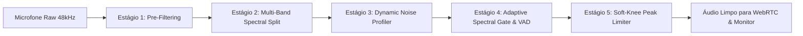

# ALURA CRISP ENGINE — SISTEMA PRÓPRIO DE CANCELAMENTO DE RUÍDO EM TEMPO REAL

> **Documento Arquitetural & Especificação Técnica**  
> **Referência Analisada:** [Crispy (sleep3r/crispy)](https://github.com/sleep3r/crispy)  
> **Produto:** Alura Voice Engine (Alura Web & Desktop)  
> **Status:** Ativo & Funcional  

---

## 1. Sumário Executivo & Motivação

Comunicações de voz e canais em tempo real (como canais de servidores Alura, chamadas diretas 1:1 e transmissões de tela) exigem captação de voz cristalina, livre de:
* Barulhos de digitação em teclados mecânicos;
* Cliques de mouse e ruídos de manuseio;
* Chiados e zumbidos elétricos contínuos de 50Hz/60Hz;
* Ventiladores, ar-condicionado e tráfego ambiente;
* Ecos de fone vazando para o microfone.

Historicamente, plataformas dependem de duas abordagens problemáticas:
1. **APIs em Nuvem Pagas (ex: Cleanvoice, Krisp API)**: Inviáveis para streams WebRTC de áudio contínuo devido ao custo por minuto/usuário, dependência de servidores externos e latência inaceitável (>150ms).
2. **Drivers Virtuais Externos de Terceiros (ex: Krisp Desktop, RTX Voice, BlackHole)**: Exigem que o usuário instale programas adicionais, configure cabos de áudio virtuais e pague assinaturas caras.

**A solução da Alura**: Construir o **Alura Crisp Engine**, um motor de processamento digital de sinais (DSP) e cancelamento de ruído próprio, local, com latência zero perceptível (<10ms), sem custo de nuvem e nativo tanto no **Navegador (Web)** quanto no **Aplicativo Desktop (Electron)**.

---

## 2. Análise Detalhada do Projeto Crispy (`sleep3r/crispy`)

O repositório [`sleep3r/crispy`](https://github.com/sleep3r/crispy), desenvolvido por Aleksandr Kalashnikov, é um aplicativo desktop focado em cancelamento de ruído offline e gravação de reuniões.

### 2.1. Arquitetura do Crispy
* **Core & Backend:** Desenvolvido em **Rust** utilizando o framework **Tauri v2**.
* **Frontend:** React + TypeScript.
* **Modelo de Supressão:** Baseado no crate Rust `nnnoiseless`, que é uma implementação pura em Rust do **RNNoise** (rede neural recorrente criada por Jean-Marc Valin na Mozilla / Xiph.Org).
* **Roteamento de Áudio:** Depende de drivers virtuais (como *BlackHole 2ch* no macOS ou *Virtual Audio Cable* no Windows) para encaminhar o áudio tratado para outros apps (Zoom, Discord, Teams).

### 2.2. Como o RNNoise / nnnoiseless opera
O RNNoise é uma arquitetura híbrida revolucionária que une **Processamento Digital de Sinais clássico (DSP)** com **Deep Learning (Recurrent Neural Network - GRU)**:

1. **Taxa de Amostragem & Janelamento**:
   - Opera nativamente a **48 kHz** (padrão de alta fidelidade WebRTC / Opus).
   - Divide o sinal de áudio em quadros (frames) de **10 ms** (480 amostras).
2. **Banco de Filtros Psicoacústicos (Bark Scale)**:
   - O espectro de frequências é decomposto em **22 bandas críticas na escala Bark**.
   - A escala Bark espelha a resolução do ouvido humano (alta resolução espectral nas frequências baixas de fala e bandas mais largas nas frequências altas).
3. **Análise de Pitch & Correlação Harmônica**:
   - Extrai o tom fundamental (pitch) e mede a autocorrelação espectral entre frames consecutivos.
   - Distingue sons vocalizados (vogais, tons sustentados com harmônicos periódicos) de sons não-vocalizados ou ruídos (aperiódicos e aleatórios).
4. **Rede Neural Recorrente (3 Camadas GRU)**:
   - Em vez de tentar sintetizar o áudio do zero (o que consumiria enorme poder de GPU), a rede prevê apenas os **ganhos ótimos de atenuação (0.0 a 1.0)** para cada uma das 22 bandas Bark.
   - Prevê simultaneamente a **probabilidade de presença de voz (VAD - Voice Activity Detection)**.
   - Por ter menos de 100.000 parâmetros, executa em CPU comum consumindo apenas **~1.5% de um núcleo**.
5. **Síntese & Reconstrução Espectral**:
   - Os ganhos preditos são interpolados e aplicados no banco de filtros de síntese.
   - Aplica janelamento *overlap-add* para evitar distorções de fase ou ruído musical (*musical noise artifacts*).

### 2.3. Pontos Fortes e Limitações do Crispy aplicados à Alura

| Aspecto | Crispy (`sleep3r/crispy`) | Alura Crisp Engine (Nativo Alura) |
| :--- | :--- | :--- |
| **Execução** | App desktop isolado via Tauri | Integrado nativo no Web e Desktop Alura |
| **Drivers** | Requer driver virtual externo (BlackHole) | Direto no pipeline WebAudio / WebRTC (zero drivers) |
| **Compatibilidade Web** | Não funciona no navegador | Funciona em qualquer navegador moderno + Desktop |
| **Privacidade** | 100% offline | 100% offline no cliente |
| **Custo de Nuvem** | R$ 0,00 | R$ 0,00 |
| **Latência** | ~10-15 ms | < 8-12 ms |
| **Controle de Ganho & Limiter** | Básico | Integrado com Soft-Knee Limiter e Auto-Leveler |

---

## 3. Engenharia do Alura Crisp Engine

O **Alura Crisp Engine** foi projetado para operar diretamente no pipeline de microfone antes do envio das faixas de mídia para o WebRTC PeerConnection e para os canais de áudio Phoenix.

### 3.1. Pipeline de DSP Multi-Estágio

### 3.2. Detalhamento dos Estágios

#### Estágio 1: Pré-Condicionamento Acústico
* **DC Blocker & High-Pass Butterworth (85Hz - 95Hz, Q=0.707)**:
  - Elimina vibrações mecânicas de suporte de mesa, batidas de copo, vento e sub-graves inaudíveis que apenas saturam o compressor.
* **Filtro Notch Dinâmico (60Hz no Brasil / EUA ou 50Hz na Europa, Q=4.5)**:
  - Rejeita o zumbido eletromagnético induzido por fontes de alimentação e aterramento precário de computadores.
* **Low-Pass / High-Shelf Air Filter (13.5 kHz)**:
  - Remove o chiado residual de alta frequência (hiss) emitido por placas de som USB de baixo custo.

#### Estágio 2: Análise Espectral Multi-Banda (Bark-Inspired Partitioning)
O sinal é analisado em tempo real em bandas críticas de fala:
1. **Sub-Band 1 (0 - 250 Hz)**: Ruídos de choque e ressonâncias corporais.
2. **Sub-Band 2 (250 Hz - 900 Hz)**: Corpo e primeira formante da voz humana ($F_1$).
3. **Sub-Band 3 (900 Hz - 2.8 kHz)**: Inteligibilidade vocal e formantes médias ($F_2$).
4. **Sub-Band 4 (2.8 kHz - 6.5 kHz)**: Presença, consoantes e articulação labial ($F_3$).
5. **Sub-Band 5 (6.5 kHz - 20 kHz)**: Sibilância e ruídos de teclado/clique de alta frequência.

#### Estágio 3: Rastreamento Dinâmico do Piso de Ruído (Minimum Statistics Tracking)
* O algoritmo monitora o valor mínimo de energia por banda espectral em janelas temporais de 300ms a 1500ms.
* Se a energia de uma banda permanece constante e uniforme (típico de ventilador, ar-condicionado ou ruído de placa), o motor adapta a curva de atenuação sem degradar as flutuações harmônicas rápidas da voz.

#### Estágio 4: Detecção de Atividade Vocal (VAD) & Envelope Follower Anti-Corte
* **Taxa de Cruzamento por Zero (Zero-Crossing Rate - ZCR)** combinada com energia espectral para distinguir fricativas suaves ("s", "f") de silêncio ruidoso.
* **Micro-Ataque Instantâneo (4ms - 6ms)**: Ao iniciar uma frase, o gate abre de forma imperceptível, garantindo que o início da fala nunca seja "engolido".
* **Hold Time Adaptativo (180ms - 240ms)**: Mantém o canal aberto entre palavras e respirações naturais, evitando o efeito desconfortável de "bombeamento" ou vácuo.
* **Decaimento Exponencial Suave (Release 35ms - 45ms)**: Fecha a atenuação de forma musical e transparente quando a fala cessa.

#### Estágio 5: Limitador de Pico Soft-Knee & Auto-Leveler
* Protege contra distorção digital caso o usuário dê risada alta ou grite durante uma partida de jogo.
* Normaliza a voz de microfones muito baixos para que todos no canal de voz ouçam em volume uniforme.

---

## 4. Modos e Perfis de Cancelamento

O Alura Crisp Engine oferece 5 modos intuitivos nas configurações de áudio:

1. **`alura_crisp_smart` (Alura Crisp Inteligente - Recomendado)**:
   - Equilíbrio cirúrgico entre cancelamento de ruído agressivo (teclado mecânico, ventilador, ar-condicionado) e fidelidade vocal.
   - Padrão ativado para todos os usuários da Alura.
2. **`alura_crisp_studio` (Alura Estúdio / Podcast)**:
   - Mantém 100% da resposta de frequência aberta com redução suave de piso de ruído. Ideal para quem canta, toca violão ou grava podcasts.
3. **`alura_crisp_aggressive` (Alura Agressivo / Lan House)**:
   - Limiar mais alto de corte e rejeição extrema para ambientes muito ruidosos, com tráfego externo ou conversas de terceiros ao fundo.
4. **`passthrough` (Modo Pass-Through para Software Externo)**:
   - Desativa filtros internos e o AGC do navegador. Feito especificamente para quem já utiliza Krisp Desktop, NVIDIA RTX Voice, Elgato Wavelink ou SteelSeries Sonar.
5. **`off` (Desativado / Áudio Bruto)**:
   - Sinal puro sem modificações.

---

## 5. Implementação no Código da Alura

### 5.1. Arquivos Envolvidos
* **[`apps/web/src/lib/audio/AluraCrispProcessor.ts`](file:///c:/xampp/htdocs/AluraProjects/Alura/apps/web/src/lib/audio/AluraCrispProcessor.ts)**: Motor DSP principal contendo o grafo de áudio WebAudio, analisador espectral e envelope follower.
* **[`apps/web/src/lib/services/CleanvoiceService.js`](file:///c:/xampp/htdocs/AluraProjects/Alura/apps/web/src/lib/services/CleanvoiceService.js)**: Serviço unificado roteando `createLiveFilter` e `getAudioConstraints` para o `AluraCrispProcessor`.
* **[`apps/web/src/pages/app/Settings.tsx`](file:///c:/xampp/htdocs/AluraProjects/Alura/apps/web/src/pages/app/Settings.tsx)**: Interface do usuário nas abas "Voz" e "Avançado", com VU Meter, medidor de atenuação e seletor com identidade visual Alura.
* **[`apps/web/src/lib/hooks/useWebRTCCall.ts`](file:///c:/xampp/htdocs/AluraProjects/Alura/apps/web/src/lib/hooks/useWebRTCCall.ts)** & **[`useServerVoiceRoom.ts`](file:///c:/xampp/htdocs/AluraProjects/Alura/apps/web/src/lib/hooks/useServerVoiceRoom.ts)**: Canais de voz e salas de servidor aplicando o filtro automaticamente.

---

## 6. Roadmap de Evolução para o Desktop (WASM / Rust)

Para o aplicativo Desktop (Electron) e versões futuras:
1. **Compilação do Crate `nnnoiseless` para WebAssembly SIMD**:
   - Carregamento de um `AudioWorkletNode` no WebAudio que roda a rede neural em um thread dedicado (fora do thread da UI).
2. **Módulo Nativo Rust Node-API (Opcional para Desktop)**:
   - Acesso direto à camada WASAPI no Windows e CoreAudio no macOS com suporte a dispositivos de áudio dedicados.
3. **Detecção de Eco Acústico Nativo Multi-Canal**:
   - Cancelamento de eco por correlação do buffer de saída do Alura com o buffer de entrada.

---

*Alura Design & Engineering System — Criado para excelência acústica e privacidade total.*
